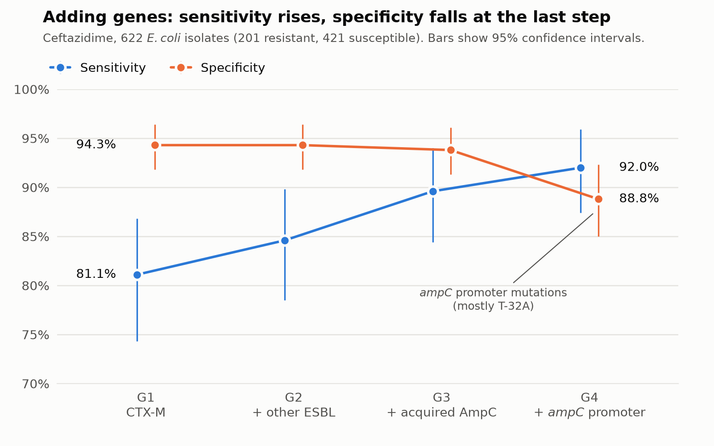

# E. coli AMR Genomics

## What is this project about?

There are two ways to detect antimicrobial resistance (AMR) in the laboratory:

- **Phenotypic testing:** expose the bacterium to different concentrations of the antibiotic and see whether it can grow. This is antimicrobial susceptibility testing (AST).
- **Genotypic testing:** read the bacterium's DNA and look for genes known to cause resistance.

As a Medical Laboratory Scientist, I routinely work with phenotypic testing. I became curious about what examining bacterial genes could add to the susceptibility testing we rely on in the laboratory.

This project explores that question using *E. coli* and one antibiotic, ceftazidime. I started with CTX-M genes, an important cause of extended-spectrum beta-lactam resistance in *E. coli*, and then added other resistance determinants step by step. At each stage, I asked two questions:

1. Does including more resistance determinants identify a greater proportion of the bacteria found to be resistant in the laboratory?
2. How many bacteria found to be susceptible in the laboratory are incorrectly classified as resistant by the gene-based approach?

### Three terms used throughout

- **Sensitivity:** Of the bacteria classified as resistant by laboratory testing, the proportion also classified as resistant by the gene-based approach.
- **Specificity:** Of the bacteria classified as susceptible by laboratory testing, the proportion also classified as susceptible by the gene-based approach.
- **False positive:** A bacterium classified as resistant by the gene-based approach but found susceptible by laboratory testing.

## The data

I used a public dataset from the University of Liverpool: 762 *E. coli* isolates from patient samples, collected by Liverpool Clinical Laboratories (Liverpool University Hospitals NHS Trust) between 2017 and 2021.

For each isolate, the dataset provides:

- **A genome:** the bacterium's DNA, sequenced and assembled by the dataset authors.
- **Laboratory results:** minimum inhibitory concentrations (MICs) measured by agar dilution at the University of Liverpool, and disk diffusion results from the clinical laboratory.

Of the 762 isolates, 736 have laboratory results, and 721 of these include a ceftazidime MIC. These counts are for the whole dataset, before my quality checks. The counts after the quality checks are under "What I did". From the laboratory results, I used only the ceftazidime MIC.

The dataset is openly available under a CC BY 4.0 licence at [datacat.liverpool.ac.uk/3008](https://datacat.liverpool.ac.uk/3008/). The laboratory results are included in this repository's `data/` folder. The genomes are not, because of their size (about 4 GB), but a script downloads them.

## What I did

**1. Checked the quality of every genome.** Before looking for any genes, I checked all 762 genomes for problems, using measurements of the genomes only (size, how fragmented they were, which species they matched, and signs of contamination). I excluded 13: 9 were not *E. coli*, 2 were mixed cultures, 1 was a failed assembly, and 1 was contaminated with another organism. That left 749 genomes.

**2. Searched each genome for resistance genes.** I used AMRFinderPlus (version 4.2.7, database 2026-08-07.1), a tool from the US National Center for Biotechnology Information (NCBI) that compares a genome with a curated catalogue of known resistance genes.

**3. Sorted the genes into groups and built them up step by step.** Each step adds a group to the one before:

| Step | Genes included |
|---|---|
| **G1** | CTX-M genes |
| **G2** | G1 + other ESBL genes (ESBL variants of SHV, TEM and OXA, for example) |
| **G3** | G2 + acquired AmpC genes (CMY and DHA, for example) |
| **G4** | G3 + two *ampC* promoter mutations (C-42T and T-32A) associated with increased production of the bacterium's own AmpC enzyme |
| **G5** | G4 + carbapenemase genes (supplementary only) |

For each step, every genome was called **positive**, **negative** or **indeterminate**. A call was indeterminate for one of two reasons:

- **The gene was only partly present in the assembled genome**, for example because it was cut off at the end of a DNA fragment.
- **The gene or mutation was found, but its effect on ceftazidime is not established**, for example an *ampC* promoter mutation other than the two listed above, or a gene variant that the AMRFinderPlus catalogue does not describe as extended-spectrum.

Indeterminate calls were set aside, never counted as negative. These rules were written using the gene information only.

**4. Compared the gene calls with the laboratory results.** I classified each isolate's ceftazidime MIC using EUCAST breakpoints: **resistant** if above 4 mg/L, **susceptible** if 1 mg/L or below. Isolates in between (2–4 mg/L) were kept out of the main comparison.

The number of isolates at each stage:

| Stage | Isolates |
|---|---|
| Genomes in the original dataset | 762 |
| Kept after the quality checks | 749 |
| Of these, with laboratory results | 724 |
| Of these, with a ceftazidime MIC | 710 |
| Clearly resistant or susceptible | **644** (207 resistant, 437 susceptible) |
| Both G1 and G4 gave a definite call | **623** (202 resistant, 421 susceptible) |

The 21 isolates between 644 and 623 (5 resistant, 16 susceptible) were not removed by the quality checks. They were left out of the G1 versus G4 comparison because their G4 call was indeterminate. Comparing both gene groups on the same 623 isolates keeps the comparison fair.

**Confidence intervals.** Some isolates have almost identical genomes. They may be repeat samples of the same strain, but this was not confirmed. To avoid counting them as independent isolates, I grouped genomes with a DNA similarity score (Jaccard index) of 0.99 or more, which is about 99.97% sequence identity. This gave 653 groups: 44 groups of 2 to 12 genomes, and 609 single genomes. I then calculated 95% confidence intervals by resampling whole groups 10,000 times. This method is called a cluster bootstrap.

## What I found

**Adding more genes caught more resistant bacteria, but also wrongly flagged more susceptible ones.**

Comparing CTX-M alone (G1) with all four gene groups (G4), on the same 623 isolates (202 resistant, 421 susceptible):

| | CTX-M only (G1) | All four groups (G4) |
|---|---|---|
| Resistant isolates correctly flagged | 163 of 202 | 186 of 202 |
| **Sensitivity** | **80.7%** (73.8–86.5) | **92.1%** (87.5–95.9) |
| Susceptible isolates wrongly flagged (false positives) | 24 of 421 | 47 of 421 |
| **Specificity** | **94.3%** (91.8–96.4) | **88.8%** (85.0–92.3) |

*95% confidence intervals in brackets.*



*Sensitivity and specificity at each step, on the 622 isolates where all four gene groups gave a definite call. This is one fewer than the 623 in the table above: one isolate had an indeterminate G2 call, so it cannot appear at the G2 step.*

Going from G1 to G4 detected **23 more resistant isolates**, but also flagged **23 more susceptible isolates** as resistant. The number of false positives almost doubled, from 24 to 47.

**Where the changes came from.** The isolates newly flagged at each step were:

- **G2 (other ESBL genes):** 7 isolates, all resistant. All 7 carried SHV-12.
- **G3 (acquired AmpC genes):** 16 isolates: 11 resistant, 2 intermediate, 2 susceptible and 1 without a ceftazidime MIC.
- **G4 (*ampC* promoter mutations):** 32 isolates: 5 resistant, 5 intermediate, 21 susceptible and 1 without a ceftazidime MIC. Nearly all of the extra false positives came from one mutation, T-32A: of the 25 isolates carrying it, 21 were susceptible and only 1 was resistant.

In short, adding other ESBL and acquired AmpC genes improved detection at little cost, while the *ampC* promoter step added most of the false positives.

**Supplementary (G5):** adding carbapenemase genes raised sensitivity to 96.0%, with only one more false positive (specificity 88.6%).

## What it means

For ceftazidime in this collection, looking for CTX-M genes alone missed about one in five resistant isolates. How closely the gene-based approach agreed with laboratory testing depended on which resistance determinants were included.

* Other ESBL genes and acquired AmpC genes: Adding these determinants identified many resistant isolates that CTX-M alone missed, while incorrectly classifying very few susceptible isolates as resistant.
* The ampC promoter mutation T-32A: Adding this variant did not improve classification. Most isolates carrying it were susceptible in the laboratory, so counting it as a resistance marker introduced more false positives than additional resistant isolates detected. The other promoter mutation, C-42T, was found mostly in resistant or intermediate isolates.
* Resistant isolates not explained by the genes examined: Even after including all four gene groups, 16 resistant isolates had none of the resistance determinants examined. Their resistance may be due to mechanisms not covered by this analysis.

The findings show that adding more resistance determinants does not automatically improve gene-based classification. Each addition needs to be assessed by how many additional resistant isolates it identifies and how many susceptible isolates it incorrectly classifies as resistant.

From my perspective as a Medical Laboratory Scientist, this reinforces the importance of interpreting genomic resistance findings alongside laboratory susceptibility results.

## Limitations

- **The study was not fully blinded.** Before the analysis plan was written, an initial assessment of the dataset produced summary comparisons of CTX-M and related genes with cephalosporin results. These findings informed the research question, the choice of ceftazidime and the gene groups evaluated. After that, genomes were excluded using genome measurements only. The gene classification rules were written without using the laboratory results, and were fixed before the final analysis. So the results describe this collection. They are not a test of an idea that was fixed before the data were explored.
- **The isolates are not a random sample.** The dataset authors chose isolates to cover important resistance mechanisms. They did not sample patients at random, so some less common resistance patterns are over-represented. The results may not reflect how the gene-based approach would perform in a routine laboratory population.
- **One collection, one species, one antibiotic.** All isolates come from Liverpool, 2017–2021. The results may not apply to other places, other bacteria or other antibiotics.
- **Finding a gene does not show how strongly it works.** The approach only records whether a gene or mutation is present. It does not measure how much enzyme the bacterium makes, which matters most for the *ampC* promoter mutations. Other causes of resistance, such as changes to the outer membrane, were not examined.
- **Some genes may appear incomplete in the data.** The genomes were assembled from short pieces of DNA. This process can leave part of a gene unresolved, so a gene that is complete in the bacterium can appear incomplete in the assembled genome. This is one reason some gene calls were indeterminate. I also did not check whether the acquired AmpC genes were on a plasmid or on the chromosome.
- **Some isolates were left out of the main comparison.** These were the intermediate isolates (2–4 mg/L) and those with indeterminate gene calls. Counting the indeterminate calls either way changes the results only a little. For G4, sensitivity stays between 89.9% and 92.3%, and specificity between 85.6% and 89.2%.

## How to rerun it

There are two ways to rerun this work.

### Quick rerun (about one minute)

This repeats the main analysis from the saved tables in `data/`: linking the gene calls to the laboratory results and calculating every number in "What I found". It does not repeat the genome download, the quality checks or the gene search. It needs Python 3.12 and was tested on Windows 11.

```bash
git clone https://github.com/Ekoche1/ecoli-amr-genomics.git
cd ecoli-amr-genomics
pip install -r requirements.txt
python scripts/16_link_and_analyse.py
python scripts/17_genes_behind_each_step.py
python scripts/18_summary_tables.py
python scripts/19_make_figure.py
```

The tables written to `results/` should match the ones already there, and the figure is redrawn in `figures/`. On Linux and macOS, the rerun tables have the same content but different line endings, so Git may list them as changed.

### Full rerun (several hours)

This repeats everything: downloading the genomes, the quality checks, the gene search with AMRFinderPlus, the gene classification and the analysis. AMRFinderPlus needs Linux, macOS or Windows with WSL. I used WSL on Windows 11. On a standard laptop it takes about:

- 2 hours to download the genomes (this depends on the Liverpool server),
- 2 hours for the quality checks,
- 6 hours for the gene search.

What was tested after the scripts were tidied for this repository:

- The genome download and the quality checks were rerun in full. The results were identical.
- The gene classification and the analysis were rerun from the saved AMRFinderPlus outputs. The results were identical.
- The gene search on all 749 genomes was run once. After tidying, its script was rerun on 3 genomes, and the output was identical to the original run.

The steps, in order, are in [`scripts/README.md`](scripts/README.md).

## What's in this repository

```
ecoli-amr-genomics/
├── README.md          this page
├── data/              laboratory results, quality-check results and gene calls
├── scripts/           the code, numbered in the order it runs
├── results/           the result tables
├── figures/           the main figure
├── requirements.txt   the Python packages needed
└── LICENSE            the licence for the code
```

Each folder has its own short README explaining its files.

## Credits and licence

**Data.** The genomes and laboratory results come from:

> Gerada A, Harper N, Hope W (2025). *Whole genome sequencing data for 762 clinical Escherichia coli strains with antimicrobial susceptibility meta data.* University of Liverpool Data Catalogue. https://doi.org/10.17638/datacat.liverpool.ac.uk/3008

The dataset is shared under a CC BY 4.0 licence. I thank the authors for making it openly available.

**Software and breakpoints.** Resistance genes were found with AMRFinderPlus:

> Feldgarden M, et al. (2021). AMRFinderPlus and the Reference Gene Catalog facilitate examination of the genomic links among antimicrobial resistance, stress response, and virulence. *Scientific Reports* 11: 12728. https://doi.org/10.1038/s41598-021-91456-0

Ceftazidime MICs were interpreted with EUCAST clinical breakpoints (version 13.1).

**Licence.** The code in this repository is released under the MIT licence (see `LICENSE`). The tables I produced, in `data/` and `results/`, are shared under CC BY 4.0, the same licence as the original dataset.
